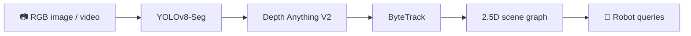
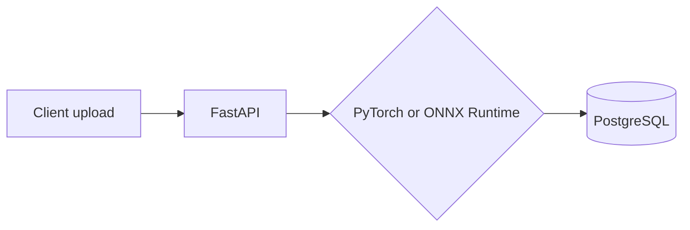

 

  

  

`✦ COMPUTER VISION ✦ GENERATIVE AI / RAG ✦ AI ENGINEERING ✦ ROBOTICS ✦`

---

## 👋 10-second tour

| | |
|---|---|
| 🎓 **Studying** | BS Robotics & Intelligent Systems, Bahria University (CGPA 3.11) |
| 🤖 **Did** | AI & ML Intern at Embotics: offline RAG for an AI Teacher Robot on Raspberry Pi |
| 🔭 **Building** | Perception, inference serving and local LLM systems |
| 🤝 **Open to** | Internships and junior roles in AI/ML, computer vision and robotics |
| 🗣️ **Languages** | Pashto · Urdu · English · Punjabi |

---

## 🚀 Flagship systems

### 👁️ [RoboSight](https://github.com/BabarKhanD/robosight): robotic visual perception, software only

Turns a single camera image into a spatial scene graph and answers questions like *"which object is closest?"* with a rules-based query layer. Runs on CPU, no hardware needed.

### ⚡ [VisionServe](https://github.com/BabarKhanD/visionserve): production CV inference platform

| Backend | Mean latency (CPU) | FPS | RAM |
|---|---|---|---|
| PyTorch | 195.9 ms | 5.09 | 300 MB |
| **ONNX Runtime** | **137.2 ms** | **7.31** | **142 MB** |

**1.43× faster**, 73 passing tests, Docker Compose deployment, model versioning, structured logging.
`FastAPI` `PostgreSQL` `Docker` `PyTorch` `ONNX Runtime`

---

## 🧪 More projects

<table>
<tr>
<td width="50%" valign="top">

### 🩻 [Bone Metastasis Detection](https://github.com/BabarKhanD/bone-scan-metastasis-detection)
Dual-view CNN on nuclear medicine bone scans with Grad-CAM. **Focal Loss CNN caught 15/15** metastasis cases (baseline CNN 8/15, ViT 4/15).
`PyTorch` `Focal Loss` `Grad-CAM`

</td>
<td width="50%" valign="top">

### 🔍 [Visual Anomaly Inspection](https://github.com/BabarKhanD/visual-anomaly-inspection)
Unsupervised defect detection with ResNet-50 features. **0.847 ROC-AUC, 0.969 AP** on MVTec AD 2 Sheet Metal.
`PyTorch` `OpenCV` `Scikit-learn`

</td>
</tr>
<tr>
<td width="50%" valign="top">

### ⚽ [Football AI Tactical Analysis](https://github.com/BabarKhanD/football-ai-tactical-analysis)
Custom YOLO detection, team classification, possession analysis and player activity recognition from match video.
`YOLO` `ByteTrack` `K-Means`

</td>
<td width="50%" valign="top">

### 🧠 [Local AI Research Assistant](https://github.com/BabarKhanD/local-ai-research-assistant)
100% local RAG for paper Q&A, summaries and comparison. BGE + ChromaDB + Gemma 3 via LM Studio.
`RAG` `ChromaDB` `Local LLMs`

</td>
</tr>
<tr>
<td width="50%" valign="top">

### 🏎️ [F1 Track Limits](https://github.com/BabarKhanD/f1-track-limits-ambiguous-classification)
Classifier for the ambiguous "no advantage" cases. **F1-macro 0.887, ROC-AUC 0.942** over 4,254 incidents.
`FastF1` `Random Forest` `SHAP`

</td>
<td width="50%" valign="top">

### 📄 [Resume Analyzer](https://github.com/BabarKhanD/resume-analyzer)
Offline ATS scoring and skill-gap feedback against 30 job roles using sentence embeddings.
`Sentence Transformers` `PyMuPDF`

</td>
</tr>
</table>

[🌊 AUV sensor selection](https://github.com/BabarKhanD/adaptive-sensor-selection-auv-navigation) · [🏠 Property doc intelligence](https://github.com/BabarKhanD/property-doc-intelligence) · [🛠️ Maintenance AI](https://github.com/BabarKhanD/maintenance-ai) · [❤️ Heart disease ML](https://github.com/BabarKhanD/heart-disease-prediction-ml) · [📈 Apple stock ML](https://github.com/BabarKhanD/stock_price_apple) · [🏡 House price ML](https://github.com/BabarKhanD/House-Price-Prediction-)

---

## 🧰 Loadout

`YOLO` `ONNX Runtime` `ByteTrack` `RAG` `Ollama` `ChromaDB` `Sentence Transformers` `n8n` `ESP32` `Proteus` `Cisco Packet Tracer`

---

## 💼 Experience

<b>🤖 AI & ML Intern · Embotics (Pvt.) Ltd.</b> · Jul 2026 – Sep 2026

- Offline RAG pipeline for an AI Teacher Robot: OCR, cleaning, chunking, BGE embeddings, FAISS index (111 chunks)
- Local LLM answers through Ollama (qwen2.5), compared RAG vs No-RAG on a 50-question test set
- Deployed and tested on Raspberry Pi, with audio-based interaction

<b>🧠 AI/ML Engineering Intern · DevelopersHub</b> · Jul – Aug 2025 · Best Award certificate

- Built and evaluated ML models on structured data: EDA, preprocessing, validation, clean documented code

<b>🎯 Leadership · IEEE, Bahria University</b> · 2024 – 2026

- Deputy Director (Technical): planned the IEEE E-Hunt competition · Deputy Director (Sports): IEEE RAS

<b>☎️ Earlier roles</b> · 2023

- Customer Service Representative, Bridgeway Telecom (UK B2B sales) · Appointment Setter, EDM Solutions

---

## 📊 GitHub stats

---

### 📫 Let's build something

I'm up for conversations about computer vision, RAG systems and robotics.

